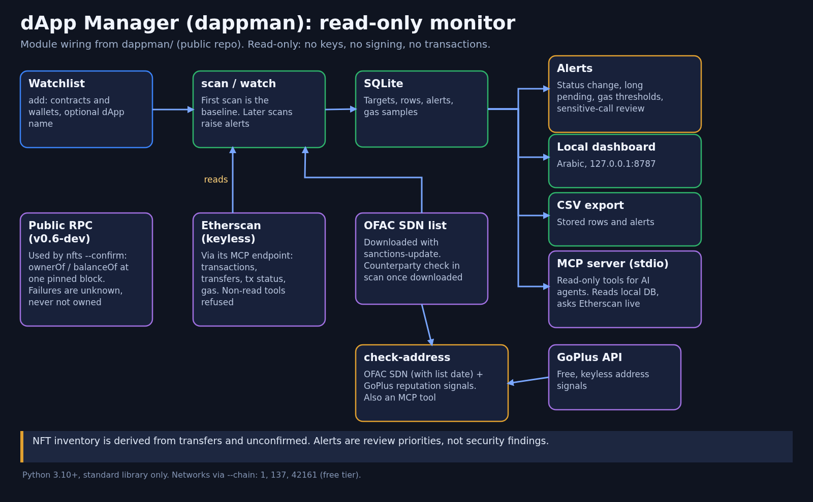
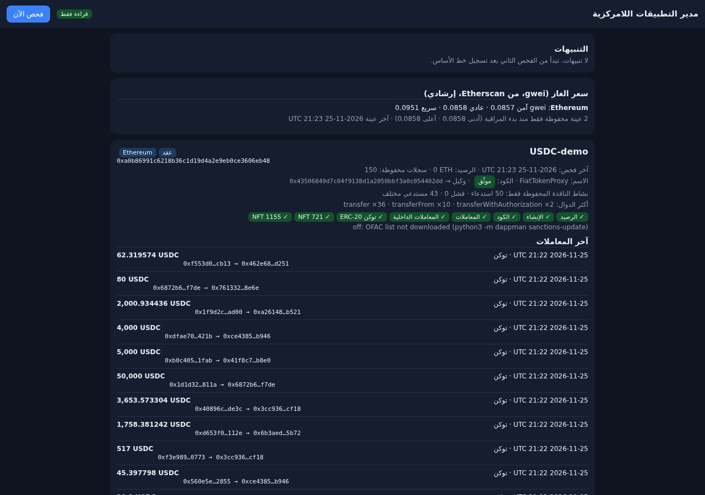

# dApp Manager — dappman (قراءة فقط)

أداة واحدة متكاملة: قائمة مراقبة ← فحص دوري ← قاعدة SQLite ← تنبيهات ← لوحة ويب محلية ← تصدير CSV.
Python 3.10+ فقط، بدون مكتبات خارجية، بدون مفتاح API، بدون حساب. Read-only: لا توقيع ولا تحريك أموال ولا نشر عقود.
العميل يرفض برمجيًا أي أداة غير قراءة.



لقطة من اللوحة المحلية بعد فحص حقيقي (قراءة فقط) لعقد USDC العام. العقد للعرض فقط وليس من عناوين المستخدم:



## التشغيل (من جذر المستودع، Python 3.10+)
الكلمات الكبيرة (مثل CONTRACT_ADDRESS وTX_HASH) خانات تستبدلها بقيمك، وليست أوامر حرفية.
```bash
git clone https://github.com/fouadbehtaher/dapp-manager
cd dapp-manager

python3 -m dappman add CONTRACT_ADDRESS --label NAME
python3 -m dappman add CONTRACT_ADDRESS --label NAME --dapp APP
python3 -m dappman add WALLET_ADDRESS --kind wallet
python3 -m dappman scan
python3 -m dappman watch --every 300
python3 -m dappman alerts --json
python3 -m dappman tx-status TX_HASH --chain 1 --json
python3 -m dappman track TX_HASH --label NAME
python3 -m dappman gas --chain 1 --json
python3 -m dappman gas-alert --chain 1 --below 0.1 --above 5
python3 -m dappman profile --dapp APP
python3 -m dappman export --out out
python3 -m dappman serve --port 8787

python3 -m dappman sync WALLET_ADDRESS --chain 1
python3 -m dappman history WALLET_ADDRESS --chain 1 --json
python3 -m dappman nfts WALLET_ADDRESS --chains 1,137,42161
python3 -m dappman check-address 0xADDRESS --chain 1
python3 -m dappman sanctions-update
python3 -m dappman chains
python3 -m dappman verify-identity 0xADDRESS --chain 1
python3 -m dappman verify-traces 0xADDRESS --chain 1 --max 25
python3 -m dappman mcp-serve

python3 -m unittest discover -s tests -v
```

- `scan`: الأول خط أساس، الثاني فصاعدًا تنبيهات. `--dapp` يجمع عدة عقود تحت اسم تطبيق. الواجهة على http://127.0.0.1:8787
- `tx-status` رمز الخروج: 0 نجحت، 3 فشلت، 4 معلّقة، 5 غير موجودة، 6 غير متاحة. الشبكات: `--chain 1` (Ethereum) أو 137 أو 42161.
- `--json` يطبع JSON فقط على stdout؛ الأخطاء على stderr.
الشبكات: 1 (Ethereum) و137 (Polygon) و42161 (Arbitrum) عبر `--chain`.

## أتمتة سير العمل (قراءة وتنبيه فقط)
- **حالة المعاملة:** `tx-status` يفرّق بين خمس حالات: نجحت (receipt status 1)، فشلت (0 مع سبب Etherscan إن وُجد)، معلّقة (Etherscan يعرفها بلا بلوك)، غير موجودة (لا سجل لها عند Etherscan على هذه الشبكة: لم تُبثّ أو أُسقطت أو شبكة خاطئة أو لم تُفهرس بعد، ولا يمكن التمييز بينها)، وغير متاحة (خطأ API/شبكة أو إجابة متناقضة: الحالة مجهولة وليست نجاحًا). ملاحظة مهمة: نقطة get_transaction_status وحدها تُرجع isError=0 لهاش غير موجود، لذلك لا تُستخدم منفردة. رمز الخروج يسهّل الربط بسكربتات أخرى، و`--json` للقراءة الآلية.
- **التتبّع:** `track` يضيف المعاملة للمراقبة؛ كل `scan`/`watch` يُنبّه عند تغيّر الحالة، وعند بقائها معلّقة 30 دقيقة من أول فحص لنا (لا نعرف قبل ذلك).
- **الغاز:** `gas` و`scan` يسجّلان عينة من Etherscan gas oracle بوحدة gwei، و`gas-alert` ينبّه عند عبور عتبة أدنى/أعلى (مرة عند العبور وليس في كل فحص). القيم إرشادية وتغطي عيناتك المحفوظة فقط، وليست توقعًا لأفضل وقت. غير متاح الغاز يظهر كخطأ ولا يتحول لصفر.
- لا يغيّر الأداة أي رسوم، ولا يرسل أو يسرّع أو يلغي معاملات، ولا يراسل عملاء أو أنظمة خارجية. الشبكات المجانية: 1 و137 و42161.

## التنبيهات
**جديد v0.4:** تنبيه `sensitive_call` بمستوى «أولوية مراجعة» (وليس نتيجة أمنية): يُطلق فقط عند معاملة خارجية مباشرة **إلى** العقد المراقَب، على عقد منشور كوده المصدري في Etherscan (وجود SourceCode فقط؛ لا يُجلب الـABI ولا يُتحقق منه)، واسم الدالة (نقل الملكية، ترقية proxy، admin، أدوار، pause، mint، blacklist، سحب طارئ) يُقبل فقط إذا طابق keccak256 للتوقيع أول 4 بايت من input المعاملة الفعلي. هذا فحص اتساق بين اسم وselector وليس تحققًا من ABI، وليس دليلًا أن الاسم هو الدالة الوحيدة بهذا الـselector (تصادم selectors ممكن نظريًا). المحاولة المرتدّة (reverted) تظهر كمعلومة فقط بلا تغيير حالة متوقع. التنبيه تطابق اسم/selector وليس إثبات هجوم أو تغيّر حالة: راجع المعاملة. لا يرى الاستدعاءات الداخلية أو عبر عقد وسيط (multisig/router) ولا المعاملات الصادرة من العقد. (v0.5: المعاملات الداخلية تُجمع كسجل تاريخي، لكن تحليل أسماء الدوال لها غير مدعوم ولا تُطلق sensitive_call.)

معاملة جديدة، معاملة فاشلة، قيمة كبيرة (`--big`)، تحويلات ERC-20 جديدة، تغيّر حالة التوثيق، تغيّر hash الكود المصدري (critical)، تغيّر implementation للـproxy (critical)، فشل فئة بيانات كانت تعمل.

## جديد v0.5: السجل، NFT، السمعة والحظر، ووصول وكلاء AI

- **سجل موسّع:** الفحص الدوري يجمع الآن 5 فئات لكل عنوان: المعاملات العادية، الداخلية (Internal)، وتحويلات ERC-20 وERC-721 وERC-1155. المعاملات الداخلية بيانات للاطلاع فقط: لا تحمل أسماء دوال ولا تُطلق تنبيه sensitive_call أبدًا.
- **مزامنة تاريخية محدودة (`sync`):** تقسيم بنوافذ كتل مع نقطة استئناف لكل فئة، والتزام الصفوف صفحةً صفحة حتى لا يُفقد شيء عند الإيقاف. عند بلوغ حد المزوّد (10,000 سجل لكل استعلام) تُصغّر النافذة تلقائيًا؛ كتلة واحدة فوق الحد تُسجَّل كفجوة صريحة. هذا «مزامنة محدودة» (bounded sync) وليس أرشيفًا مضمون الاكتمال: تغطية فهرس المزوّد، وإعادة تنظيم السلسلة لاحقًا، وحدود الـAPI كلها قيود معلنة في مخرجات الأمر.
- **NFT (`nfts`):** مزامنة فئتي ERC-721/1155 عبر الشبكات (--chains) ثم اشتقاق «مخزون مرشح غير مؤكد» (انظر الحدود).
- **فحص العناوين (`check-address`):** (1) قائمة OFAC SDN الرسمية للعناوين الرقمية — المصدر https://sanctionslistservice.ofac.treas.gov/api/PublicationPreview/exports/SDN.XML — مع تاريخ نشر القائمة دائمًا. النتائج ثلاث حالات منفصلة: مدرج (مع اسم الكيان)، غير مدرج (ليس إثبات شرعية)، مجهول (القائمة غير محمّلة، أو قديمة أكثر من 7 أيام: لا يُقال «غير مدرج» بدون حداثة). التطابق بالعنوان فقط (عناوين EVM متطابقة على كل الشبكات) وليس دليل نشاط على شبكة بعينها. عبارة عن حقيقة عن القائمة وليست استنتاجًا قانونيًا. (2) إشارات GoPlus الأمنية المجانية مع ذكر مصادر بياناتها (مثل SlowMist/BlockSec) — إشارات طرف ثالث قد تخطئ بالاتجاهين، وليست حكمًا. `sanctions-update` يحدّث القائمة المحلية، والفحص الدوري يُنبّه (critical) عند أي طرف مقابل مدرج في معاملة جديدة. تسميات المنصات/الجسور المعروفة (exchange/bridge labels): لا يوجد مزوّد مجاني متحقَّق منه مدمج في هذه النسخة؛ لم يُستبعد وجود بدائل أخرى. تسميات Etherscan الرسمية ضمن خطة مدفوعة (حسب ما ظهر لنا).
- **وكلاء AI (`mcp-serve`):** خادم MCP محلي عبر stdio فقط (بلا منفذ شبكة وبلا أسرار) يتيح لـClaude Desktop وغيره قراءة البيانات المحلية والاستعلام الحي للقراءة فقط. مثال الإعداد في Claude Desktop:
  `{"mcpServers": {"dappman": {"command": "python3", "args": ["-m", "dappman", "--db", "/path/to/dappman.db", "mcp-serve"]}}}`
- **الشبكات:** `chains` يعرض ما تعلنه الـAPI الآن (47 شبكة موسومة Free-tier وقت الاختبار). تحققنا فعليًا من: 1 و137 و42161 و8453 و10. أي شبكة أخرى غير مجربة. ملاحظة: BNB (56) موسومة «Paid Plan required» في القائمة.

## الحدود (صريحة)
- أول فحص لكل عنوان (خط الأساس): آخر 50 سجلًا لكل فئة فقط. الفحوص التالية تتقدم حتى 250 سجلًا جديدًا لكل فئة؛ إن تجاوز النشاط ذلك قد تحدث فجوة فيُنبَّه عنها (ليست تغطية كاملة). السجل يتراكم من لحظة البدء فقط.
- حالة المعاملة والغاز: لا توقع لأفضل وقت ولا تشخيص كامل للمعاملات المعلّقة؛ الحالة كما يعرضها Etherscan فقط.
- نقطة Etherscan العامة بدون مفتاح، حدّ معدلها غير موثّق وقد يتغير. الأخطاء تظهر كأخطاء ولا تتحول لأصفار.
- «مخزون NFT» مشتق من التحويلات فقط (داخل ناقص خارج): مرشح غير مؤكد وليس ملكية حالية مثبتة. عقود غير قياسية بلا أحداث، فجوات الفهرسة، وإعادة تنظيم السلسلة تغيّر النتيجة. التأكيد على السلسلة متاح لهذه المرشحات عبر `nfts --confirm` (ownerOf/balanceOf عند كتلة محددة، لقطة عند تلك الكتلة وليست ملكية حالية؛ التفاصيل في قسم v0.6 أدناه). لا يكتشف أصولًا غير موجودة في السجل المحلي.
- اكتمال السجل غير مثبت: المزوّد المجاني لا يعطي ترتيب الأحداث داخل المعاملة (log index)، فالأحداث المتطابقة تُحفَظ وتُوسَم كغامضة (`identity_ambiguous_rows`) وقد تُعدّ زيادة أو نقصًا. الإصلاح في v0.6 يمنع فقد أحداث بسبب حدود الصفحات فقط ولا يضمن الاكتمال. انظر قسم v0.6.
- ملف قاعدة البيانات `dappman.db` يحوي قائمة مراقبتك: لا ترفعه (مضاف إلى .gitignore).
- ليست تدقيقًا أمنيًا: تنبيه تغيّر الكود/الـproxy مؤشر مراقبة فقط.
- لا إشعارات خارجية (Telegram/Email) بعد. اللوحة محلية على 127.0.0.1 ولا تُنشر.
- المسح الفعلي لا يتحقق من ملكية أي عقد عام؛ العناوين التجريبية عامة ولا علاقة لأصحابها.

MIT License.

---

## سكربتات النماذج الأولية (src/)

السكربتات الأولى ما زالت في `src/` كما رُفعت سابقًا (تقرير محفظة وتقرير عقد بصيغة DOCX/PDF). الأداة المتكاملة هي `dappman/` أعلاه.

## v0.6 (development version 0.6.0-dev, not a stable release): event identity, provider boundary, on-chain NFT confirmation

**Upgrading from v0.3-v0.5 (read this).** v0.5 could merge distinct events in one transaction into one stored row, so its
counts and NFT lists can be wrong and the lost rows cannot be recovered locally. On first run v0.6 migrates the database in one
transaction. Before that it writes a consistent SQLite online backup (WAL content included, integrity and row counts verified) to `<db>.pre-v2-<timestamp>.bak`; if the backup fails the migration is refused and the DB is untouched. To roll back, stop the tool and copy the `.bak` over the DB file. The old rows are kept in `txs_legacy` for audit only, are not
counted, and sync checkpoints are reset. Rebuild history per watched wallet:

    python3 -m dappman --db dappman.db scan
    python3 -m dappman --db dappman.db sync 0xYOUR_ADDRESS --chain 1

**Identity.** Internal transfers are keyed by the provider's trace id. Token transfers are keyed by contract, token id, from,
to and amount. The free provider returns no log index for token transfers, so byte-identical events in one transaction cannot
be told apart from provider duplicates: they are kept, flagged, and reported as `identity_ambiguous_rows` in `history`,
`nfts`, the dashboard and MCP. A matching count is never proof of completeness.

**On-chain confirmation.** `python3 -m dappman nfts 0xADDR --chains 1,137 --confirm` calls `ownerOf` / `balanceOf` through
keyless public RPC endpoints (config.py) at one pinned block and prints the block and host. States: `confirmed_owner`,
`not_owner`, `unknown` (reverts, unsupported contracts and RPC failures are `unknown`, never "not owned"). It confirms
candidates found in your own history. It does not discover holdings the history lacks.
A result is a snapshot AT that block, never current ownership: any later transfer of the same token deletes the saved result (and the dashboard marks a result stale if rows exist after its block). Saved results are keyed by wallet, chain, contract and token id, so they never apply to another one. Provider and RPC error text is treated as untrusted: control characters are stripped and length is capped.

**Layout.** `provider.py` (data source interface; Etherscan keyless adapter), `events.py` (row mapping and identity),
`monitor.py` (collect / persist / evaluate), `history.py` (bounded sync), `chainrpc.py`, `config.py`.

**Identity verification from receipts (v0.7).** `python3 -m dappman verify-identity 0xADDR --chain 1` fetches the
transaction receipt (`eth_getTransactionReceipt`) of every NFT transaction that still has byte-identical twin rows
and derives the ERC-721 / ERC-1155 (single and batch) transfer events from the raw logs, with their logIndex. It reconciles instead of
forcing a match: where the receipt and the provider rows differ, both counts are stored and shown (`only_receipt`, `only_provider`) and
the receipt is used for the derived inventory. `--all-nft` verifies every stored NFT transaction, not only the ambiguous ones.
Each transaction ends in an explicit state: `verified`, `pending` (fewer than 12 confirmations), `unknown` (no usable answer, reason kept),
`inconsistent` (receipt contradicts the stored block/hash/logs) or `reorg_suspected` (the block hash changed since the last check).
Only `verified` receipts replace provider rows, and a transient failure never downgrades an earlier `verified` and never refreshes it: the old result keeps its date and the row shows `last_check` (state, reason, time) so the UI says "verified earlier, last check failed".
What it does not do: it does not find transactions the provider never returned, it does not cover ERC-20 twins or internal-transfer twins (internal twins: see `verify-traces` below; ERC-20 twins stay flagged), and `verified` is a 12-confirmation convention, not a finality proof. History completeness stays unproven.
Endpoints (config.py `RECEIPT_RPC_URLS`) are tried in order only when one gives no answer; an HTTP 401/403/429 stops the run and nothing is
retried on another endpoint. Their terms were reviewed (Nov 25 2026): PublicNode grants a limited, revocable licence with no published numeric limit; MEV Blocker publishes no read terms or limits. No request volume is approved, so treat both as best-effort public endpoints and set your own in `config.py` for heavy use. History, `nfts`, the dashboard and MCP (`dappman_identity_status`) show
`receipt_verified` / `ambiguous` / `provider_only` per row.

**Internal-transfer identity from traces (v0.7).** `python3 -m dappman verify-traces 0xADDR --chain 1 --max 25 --json` fetches `trace_transaction`
for each tx that has byte-identical internal-transfer rows and compares the value-moving calls touching your address with the provider rows
(failed calls, delegate/static calls, the top-level tx and zero-value calls are excluded). States per tx: `match`, `trace_has_more`,
`provider_has_more`, `mismatch`, `pending` (fewer than 12 confirmations), `inconsistent` (trace belongs to another tx or block), `unknown`.
Only an exact `match` removes the rows from `identity_ambiguous_rows`; everything else keeps them flagged.
Endpoint (config.py `TRACE_RPC_URLS`): `https://eth.drpc.org`, Ethereum only. Of 8 free keyless endpoints tried on Nov 26 2026 only this one answered `trace_transaction`
(the others returned 401/403/406, "method not found" or required an API key). dRPC's rate-limiting page (checked Nov 27 2026) says free nodes usually allow about 25 requests per second,
with a 2 second timeout per call; the tool waits 0.5 s between calls and caps a run with `--max`. Its full terms of service were NOT reviewed, so treat it as a best-effort public endpoint.
An HTTP 401/403/429 stops the run and nothing is retried elsewhere.

**What was tested (Nov 27 2026), stated plainly.** 133 unit tests pass offline (Python 3.10). One live run: public address vitalik.eth (chosen only because it has many internal transfers),
a bounded recent slice of 573 internal rows in 540 txs synced with 12 Etherscan page reads. 33 txs had twin rows (66 rows); `verify-traces` returned `match` for all 33, and a control of 20 non-twin txs also matched (53 of 53), with no refusals.
That shows trace and Etherscan agree on count, value and direction for those txs on one address and one endpoint. It does not prove the provider returned every transaction, was not run on other chains, and
history completeness and current NFT holdings remain unproven. Receipt-based NFT identity was tested live on 49 transactions.
